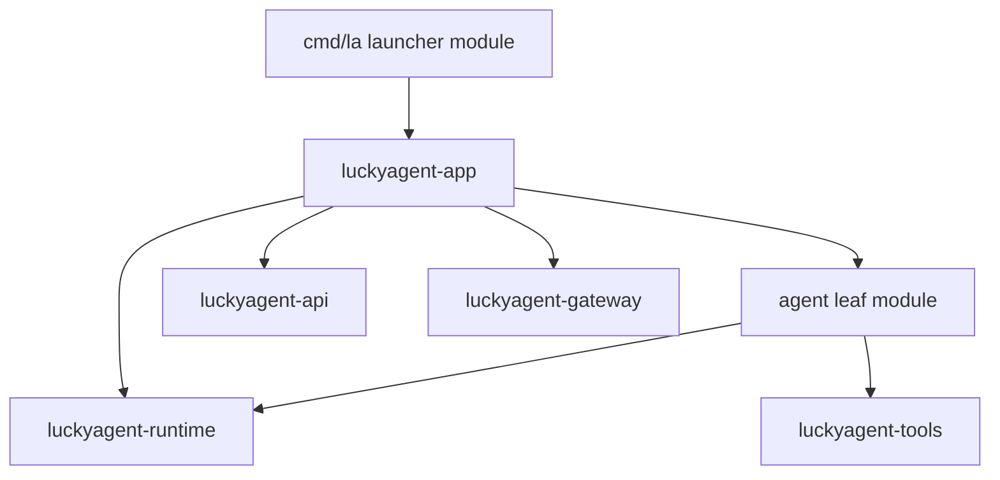

# Agent core and executable launcher

The main repository maintains the Agent implementation and a thin executable
entrypoint. Application commands and runtime backends are independent modules.
The complete product still runs in one process and builds from `cmd/la`.

## Two modules in the main repository

| Source | Module | Responsibility |
| --- | --- | --- |
| `agent/` | `github.com/yurika0211/lucky-agent/agent` | Public Agent implementation, context/loop/execution policy and core tests |
| Repository root | `github.com/yurika0211/lucky-agent` | Thin cmd/la, build/release integration and product documentation |

The separate Agent manifest prevents a dependency cycle. The launcher depends
on the application, which depends on the Agent leaf module. The Agent leaf does
not depend on the application or launcher.



## External source ownership

- `luckyagent-app`: CLI/REPL, HTTP/channel product handlers, application adapters,
  default runtime assembly, full embedding SDK, benchmarks and examples.
- `luckyagent-runtime`: configuration, model clients, sessions, memory backend,
  RAG/embedding, MCP and supporting runtime components.
- Existing tools/API/gateway modules retain generic execution, wire protocols
  and platform connections. Their implementations are not copied into the core.

Previous `internal/agent` imports are now `github.com/yurika0211/lucky-agent/agent`.
Most former host support imports are public packages under
`github.com/yurika0211/luckyagent-runtime`. Full SDK consumers use
`github.com/yurika0211/luckyagent-app/sdk`. The embed example and SDK readme
live in that app repository, not in this launcher tree.

The former in-repository `modules/appservice` is now the public package
`luckyagent-runtime/appservice`; its schema/catalog adapters live in
`luckyagent-app/appservice`. There is no third appservice module or local
replacement to an application-service directory.

## Construction and ownership

The app's bootstrap prepares resources using `runtime/bootstrap.Open`, passes
them to `agent.NewWithDependencies(Options, *Dependencies)`, then explicitly
activates application services using `Components.Start` and `StartupHooks`.
The injected core constructor does not create backends, write files or start
MCP/proactive/heartbeat services. Borrowed resources stay with the caller;
`TakeOwnership` transfers their cleanup only on successful construction.

`agent.New` and `NewWithMemory` remain compatibility constructors for default
application behavior. Shared runtime configuration and public concrete storage
types remain compatible contracts; this migration does not claim that every
configuration/storage API has become an abstract interface. Their implementation
and defaults are maintained in the runtime repository.

Existing configuration keys, paths under ~/.luckyagent, session formats,
HTTP/SSE/WS/gRPC fields and platform permission rules are unchanged.

## Build and test

```bash
# From the main repository
go build -o lh ./cmd/la
go list -f '{{.Dir}}' github.com/yurika0211/lucky-agent/agent

# Independently verify published dependency versions
GOWORK=off go build -mod=readonly -o lh ./cmd/la
GOWORK=off go test -mod=readonly ./...
(cd agent && GOWORK=off go test -mod=readonly -race ./...)
```

The parent module's `./...` skips the Agent leaf. `make test` and CI check both.
The committed portable `go.work` includes only the root and `./agent`. Normal
builds and Docker compile the checked-out Agent, so local core edits affect the
resulting executable. All external dependencies have downloadable versions.

For joint development, copy `go.work` to an ignored `go.local.work`, add the
actual app/runtime checkout paths with `GOWORK=$PWD/go.local.work go work use`,
and select it explicitly with `GOWORK=$PWD/go.local.work`. Do not add absolute
paths or local replacements to the committed workspace/manifests. When
publishing core changes, update app/launcher pins to their published commits;
final `GOWORK=off` checks verify the exact downloadable dependency versions.
